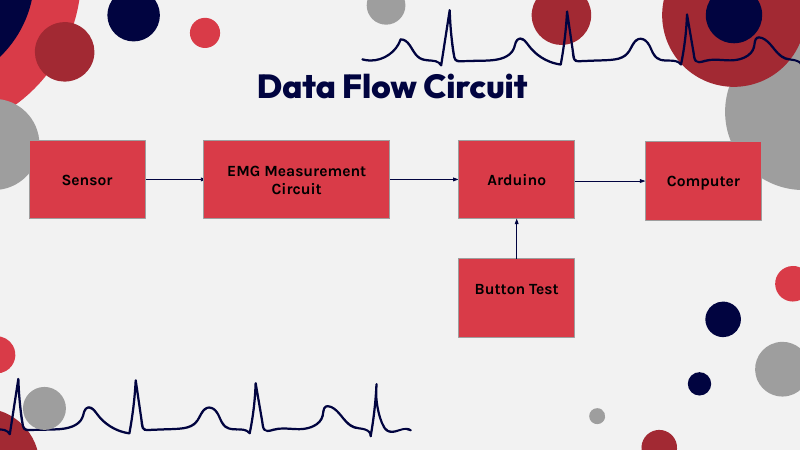
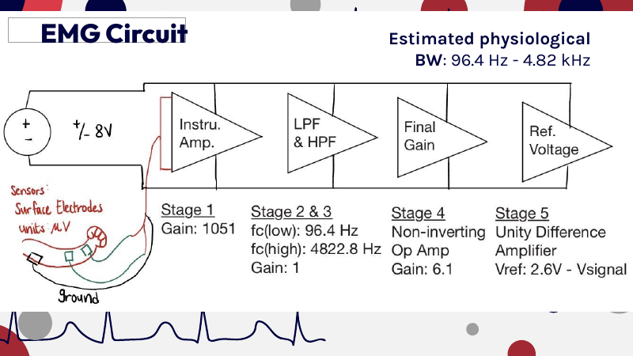
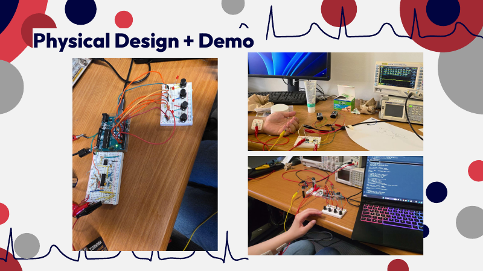
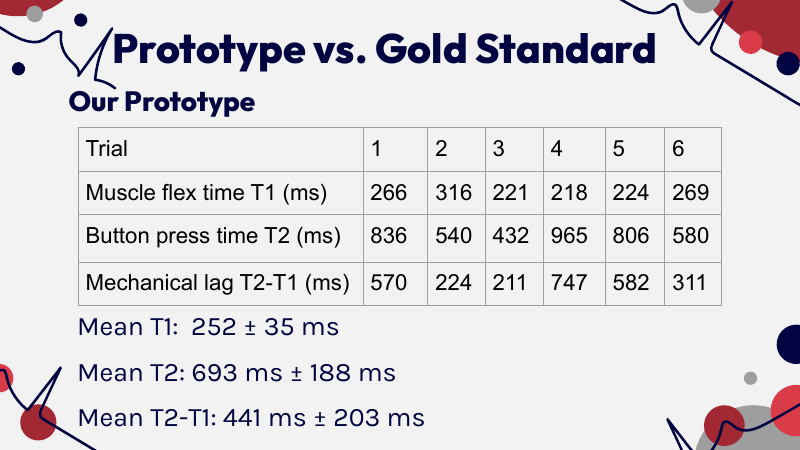

# EMG Reaction-Time Measurement System (Arduino Uno)

> A low-cost, non-invasive surface-EMG system that times muscle activation against a visual stimulus, built as an analog biopotential front end plus Arduino Uno firmware for calibration, onset detection and a four-button reaction game. Motivated by the delayed, more variable reaction times seen in Parkinson's disease.

Final project for **BioE 101** (Spring 2026, UC Berkeley, taught by Prof. Steven Conolly). Team: Anton, Madeleine, Nina and Viraj. I wrote the Arduino firmware in this repository.

- **Firmware:** [`firmware/reaction_time_final_3/reaction_time_final_3.ino`](firmware/reaction_time_final_3/reaction_time_final_3.ino)
- **Final presentation:** [`docs/BioE101_EMG_Reaction_Time_Final_Presentation.pdf`](docs/BioE101_EMG_Reaction_Time_Final_Presentation.pdf)

## Why measure reaction time with EMG?

Parkinson's disease is associated with delayed motor initiation and abnormal muscle activation, producing longer and more variable reaction times (the project cites roughly 300–500 ms for patients vs. 200–300 ms for healthy people). Needle EMG is the clinical standard but is invasive, painful and needs a trained clinician; surface EMG with Ag/AgCl electrodes is non-invasive and well suited to timing muscle-activation onset, at the cost of weaker signal and resolution. The goal was a ~$50 prototype that measures this timing with surface electrodes.

## System overview



Signal chain (from the presentation):

| Stage | Function | Design values |
|---|---|---|
| 1 | Instrumentation amplifier (differential, rejects common-mode / 60 Hz pickup) | Gain 1051 |
| 2–3 | High-pass and low-pass filtering | fc(low) 96.4 Hz, fc(high) 4822.8 Hz, gain 1 |
| 4 | Non-inverting op-amp | Gain 6.1 |
| 5 | Unity difference amplifier with reference voltage | Vref 2.6 V − Vsignal (centers signal in the ADC range) |

Total gain ≈ 1051 × 6.1 ≈ 6,400, so a 1–300 µV surface-EMG signal reaches the Arduino ADC (0–5 V, 10-bit) centered near 2.5 V. The circuit is battery powered for patient isolation.



### Signal, noise and sampling analysis

| Quantity | Value |
|---|---|
| Passband (high-pass chosen above 60 Hz and heartbeat artifacts) | 96.4 Hz – 4.82 kHz |
| Signal (flex) above baseline | ≈ 1.65 V |
| Resting noise (RMS) | ≈ 0.04 V |
| Signal-to-noise ratio | ≈ 32 dB |
| ADC | 10-bit, 0–5 V, 4.88 mV per step |
| Quantization SNR | ≈ 62 dB (not the limiting factor) |
| Anti-aliasing | Low-pass at ~4.8 kHz; Nyquist needs > ~9.6 kS/s; Uno ADC ≈ 9,615 S/s |
| Source impedance / noise matching | ≈ 5 kΩ, amplifier voltage noise (8 nV/√Hz) dominates, no matching network needed |

## Firmware

The sketch turns the Arduino Uno into the reaction-time test controller. It is memory-optimized for the Uno's 2 KB of SRAM.

**How a trial works**

1. **Calibrate (`c`)** — with the muscle relaxed, 300 samples are read over ~3 s and the baseline mean and standard deviation are computed with Welford's online algorithm (no sample array). The detection threshold is `baseline_std × THRESHOLD_MULTIPLIER` (default 4.0).
2. **Start (`s`)** — after a random 1.5–5 s delay, one of four LEDs lights up.
3. **EMG onset detection** — a 32-sample rolling RMS of the deviation from baseline is compared with the threshold; the first crossing starts the timer ("TIMER ON").
4. **Button press** — the user presses the matching button; presses are debounced (two-array, falling-edge method) and wrong buttons are reported without ending the trial.
5. **Result** — the interval from EMG onset to the correct button press is printed with a coarse category, along with a short raw-signal log (`SENSOR_LOG:`) for plotting. Timeouts (8 s) mark a trial invalid.
6. **Summary (`p`)** — prints each trial plus valid count, mean, min, max and standard deviation (up to 10 trials). **`r`** resets.

**Design choices**
- Non-blocking state machine (`IDLE → WAITING_SENSOR → TIMING → SHOW_RESULT`) after the stimulus delay.
- Rolling RMS envelope instead of a raw-amplitude threshold, so brief noise spikes are less likely to trigger.
- Threshold derived from each session's own baseline noise rather than a fixed voltage.
- All tunable parameters (threshold multiplier, delay range, timeout, debounce time) are declared at the top of the file.

### Pin map

| Pin | Function |
|---|---|
| A0 | Conditioned EMG signal (0–5 V, centered ≈ 2.5 V) |
| D2, D3, D4, D5 | LEDs 1–4 (pin → 330 Ω → LED anode, cathode → GND) |
| D6, D7, D8, D9 | Buttons 1–4 (pin → button → GND; `INPUT_PULLUP`) |
| A5 | Floating input used to seed the random generator |

### Serial commands (115200 baud)

| Key | Action |
|---|---|
| `c` | Calibrate (stay relaxed ~3 s) |
| `s` | Start a trial |
| `p` | Print all results and statistics |
| `r` | Reset trials and calibration |

### Build and run

1. Open `firmware/reaction_time_final_3/reaction_time_final_3.ino` in the Arduino IDE (or compile with `arduino-cli`), select **Arduino Uno**, and upload.
2. Open the Serial Monitor at **115200 baud**, send `c`, then `s`.

**Try it without hardware (Wokwi):** wire a potentiometer to A0, four LEDs to D2–D5 and four buttons to D6–D9. A centered potentiometer gives a baseline std and threshold of 0.00 V (normal in simulation, as there is no noise); turning the knob away from center simulates the EMG crossing the threshold.

## Prototype results (from the final presentation)



| Trial | 1 | 2 | 3 | 4 | 5 | 6 |
|---|---|---|---|---|---|---|
| Muscle flex time T1 (ms) | 266 | 316 | 221 | 218 | 224 | 269 |
| Button press time T2 (ms) | 836 | 540 | 432 | 965 | 806 | 580 |
| Mechanical lag T2 − T1 (ms) | 570 | 224 | 211 | 747 | 582 | 311 |

- Mean T1: **252 ± 35 ms** (within the 200–300 ms healthy range cited for the gold standard)
- Mean T2: 693 ± 188 ms
- Mean T2 − T1: 441 ± 203 ms
- ± values are population standard deviations over 6 trials.

The firmware's printed reaction time is the interval from EMG-onset detection to the correct button press, which corresponds to the T2 − T1 column.

**Pros:** non-invasive, ~$50 total cost, T1 inside the healthy range. **Cons:** higher variability than the clinical gold standard, and motion artifacts affect the threshold.



## Lessons learned

- **Instability:** breadboard connections were easily disturbed, breaking the circuit and making repairs difficult. Solder all connections in future builds.
- **Signal vs. interference trade-off:** the high-pass cutoff was raised from 10 Hz to 100 Hz to avoid 60 Hz interference and heartbeat artifacts, which reduced signal amplitude but also reduced injected noise.
- **Gain and filtering placement:** splitting gain and filtering across stages amplifies the biopotential without amplifying noise.
- **Test each stage as it is added:** frequent sanity checks and backtracking saved time.

## Limitations and next steps

- Six trials from a single prototype; no clinical validation, and it is not a diagnostic device.
- The detection threshold is amplitude-based, so motion artifacts can cause false triggers; band-limited envelope detection or a refractory window would help.
- The ADC's maximum rate is ≈ 9,615 S/s; the effective loop rate during a trial (RMS computation plus serial output) was not measured separately.
- Next steps: soldered or PCB build, logging of stimulus-to-EMG latency in firmware, and testing with more participants.

## Repository structure

```
.
├── README.md
├── LICENSE
├── .gitignore
├── firmware/
│   └── reaction_time_final_3/
│       └── reaction_time_final_3.ino
└── docs/
    ├── BioE101_EMG_Reaction_Time_Final_Presentation.pdf
    └── images/
```

## References

1. Bloxham C.A., Dick D.J., Moore M. Reaction times and attention in Parkinson's disease. *J Neurol Neurosurg Psychiatry* 50(9), 1178–1183 (1987).
2. Lakhani B. et al. Electrophysiological correlates of changes in reaction time based on stimulus intensity. *PLoS One* 7(5), e36407 (2012).
3. Stålberg E. et al. Standards for quantification of EMG and neurography. *Clin Neurophysiol* 130(9), 1688–1729 (2019).
4. Parkinson's Foundation. Statistics. https://www.parkinson.org/understanding-parkinsons/statistics

The full reference list is in the presentation.

## License

MIT (see [LICENSE](LICENSE)).
